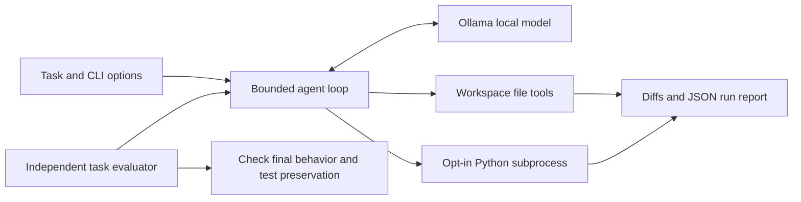

# CodePilot

**A local Python coding agent that inspects a project, edits files, runs tests, and records what happened.**

CodePilot uses a tool-calling model served by Ollama. It is designed as a small, inspectable engineering project: model text alone cannot mark a run as verified, every tool call is recorded, and both the agent loop and task outcomes can be tested separately.

Current state: experimental. Automated orchestration and execution checks pass, and a CPU Llama run completed a verified repair with independent checks. Qwen timed out repeatedly on the development machine. See the [measured results](docs/evaluation.md) for the exact configuration, successful trace, and failed attempts.

## What it does

- Six tools: list files, read files, write files, execute Python, run a Python file, and discover unittest tests.
- Workspace-relative file access with traversal, symlink escape, metadata, and common secret-path checks.
- Unified diffs for writes; `--dry-run` previews edits without modifying project files or executing Python.
- Opt-in execution in a separate Python process, execution timeouts, exit codes, stderr capture, and bounded returned output.
- Step, tool-call, and repetition limits to stop unproductive loops.
- One bounded recovery turn for premature model responses, plus runner-owned final test discovery after edits when execution and budgets allow.
- JSON run reports containing the task, model, timings, changed files, diffs, tool results, and verification status.
- Deterministic automated tests and a separate three-task real-model evaluation with independent edge-case assertions.

**Execution is not sandboxed.** With `--allow-exec`, generated Python has your user's permissions. Use trusted, disposable projects. Path restrictions apply to file tools, not arbitrary Python. See [execution limits](docs/architecture.md#execution-boundary).

## Quick start

Requirements: Python 3.10+, [Ollama](https://ollama.com/download), and a model that supports tool calling. The default is `qwen3:4b`. No third-party Python runtime packages are required.

```sh
ollama pull qwen3:4b
# If Ollama is not already running:
ollama serve
```

From the repository directory, in another terminal:

```sh
python -m codepilot --help
python -m unittest discover -s tests -v
```

On Windows, if `python` is not on PATH but the Python launcher is installed, use `py -3` in its place (for example, `py -3 -m evals.replay`).

Optional installation provides the `codepilot` command:

```sh
python -m pip install -e .
codepilot --help
```

The adapter uses Ollama's documented [`POST /api/chat`](https://docs.ollama.com/api/chat) endpoint, non-streaming responses, and function tools. Model requests have a configurable timeout; tool execution has a separate timeout.

## Try the repair demo

Copy the deliberately broken example to a disposable directory. PowerShell:

```powershell
Copy-Item -Recurse examples/repair demo-workspace
python -m codepilot "Inspect the calculator and its tests. Fix addition while preserving division behavior and the existing tests. Run the tests and summarize." --workspace demo-workspace --allow-exec
```

macOS / Linux:

```sh
cp -R examples/repair demo-workspace
python -m codepilot "Inspect the calculator and its tests. Fix addition while preserving division behavior and the existing tests. Run the tests and summarize." --workspace demo-workspace --allow-exec
```

The example starts with two failing addition tests and two passing division tests. A successful run should inspect the code, change `a - b` to `a + b`, preserve division, and run the suite. A run is not guaranteed to succeed: model output can vary. Keep the run report and inspect the actual diff.

Preview a proposal before applying changes:

```sh
python -m codepilot "Inspect the calculator and propose a fix for addition." --workspace demo-workspace --dry-run
```

Dry runs do not maintain a virtual edited filesystem: later reads still see the original files. They produce a proposal, not verification. Reports are still written outside the tool interface, by default under `.codepilot/runs/` in the directory where the command was launched.

## CLI options

| Option | Default | Purpose |
| --- | --- | --- |
| `--workspace` | `.` | Directory the file tools may access |
| `--model` | `qwen3:4b` | Ollama model name |
| `--host` | `http://127.0.0.1:11434` | Ollama base URL |
| `--cpu` | disabled | Request CPU inference when GPU offload is problematic |
| `--allow-exec` | disabled | Allow generated Python and tests to execute |
| `--dry-run` | disabled | Preview diffs without project writes or execution |
| `--timeout` | 10 | Seconds per Python subprocess |
| `--model-timeout` | 120 | Seconds per model request |
| `--max-steps` | 16 | Maximum model turns |
| `--max-tool-calls` | 40 | Maximum executed tool calls |
| `--report` | generated JSON path | Explicit report destination |
| `--quiet` | disabled | Suppress intermediate tool output |

Exit code is 0 for `completed` or `preview`, and 1 for an unverified, failed, or budget-limited run. Invalid CLI arguments return 2. File writes are enabled outside dry-run mode even when execution is disabled.

`completed` means a nonempty unittest suite passed after the latest tool-observed write or Python execution. It does not prove the code meets every requirement or that tests are sufficient. `unverified` preserves that distinction when the model stops without current test evidence.

## Evaluate model behavior

Try a deterministic workflow demo without Ollama:

```sh
python -m evals.replay
```

It prints an observed failure, an applied diff, and a passing retest using real files and subprocesses. Its model responses are scripted and explicitly labeled; it is not a model evaluation.

```sh
python -m evals.run
python -m evals.run --case sum --model qwen3:4b
python -m evals.run --case sum --cpu --model-timeout 180
```

The recorded verified live run used this command on Windows with the already installed Llama model:

```powershell
py -3 -m evals.run --case sum --cpu --model llama3.2:latest --model-timeout 240
```

It completed in 190.625 seconds. The original tests were preserved, runner-owned test discovery passed, and independent edge cases passed. This is a single recorded smoke task, not a general accuracy benchmark. The [sanitized full trace](docs/results/verified-llama-trace.json) includes the failed intermediate calls and final verification.

Each case starts in a fresh temporary project with a seeded bug and a visible regression test. The evaluator checks the buggy baseline, runs the agent, then checks independent edge cases and confirms the original test file was preserved. JSON summaries, full run traces, and final solutions are saved under `.codepilot/evaluations/`.

This executes model-generated code. Use the same execution precautions as the demo. The three toy tasks measure behavior on these fixtures only; they do not establish general coding accuracy. Unit tests use a scripted model double; they validate orchestration, not model intelligence. See [measured results](docs/evaluation.md).

## Design and project layout



```text
codepilot/          Model adapter, agent loop, tools, and CLI
tests/              Agent, tool, HTTP contract, CLI, and evaluator tests
evals/              Three seeded tasks and independent checks
examples/repair/    Intentionally broken calculator demo
docs/               Architecture, results, and interview/demo guide
.github/workflows/  CI configuration for Windows/Linux and Python 3.10/3.12
legacy/             Original prototype and exploratory examples
agents.py, tools.py Compatibility entry points for the new package
```

Original scripts and samples are retained in `legacy/` for reference; the supported implementation is `codepilot/`. The compatibility `tools.py` functions now require `allow_exec=True` for execution. `agents.py` accepts the same CLI options as `python -m codepilot`.

## Known limits

- Python projects and unittest discovery only; no shell tool, browser automation, or multi-language runner.
- No OS/container sandbox, automatic rollback, process-tree isolation, or hostile-code containment.
- Limits apply to model turns, calls, individual subprocess time, file sizes, and returned output. There is no global run deadline or disk quota.
- An executed program can edit files outside the tracked write tool. `changed_files` records only applied `write_file` operations.
- Reports contain tasks, model messages, file contents supplied to tools, and outputs. Review before sharing. A remote `--host` sends prompts and tool results to that server.
- The prompt asks the model to preserve tests; the normal runner does not enforce that. The independent task evaluator checks preservation for its fixtures.
- No public benchmark score or production-readiness claim. GitHub CI must run after the project is pushed before its remote status is known.

For a short presentation and defensible resume wording, see [the demo and interview guide](docs/demo.md).
